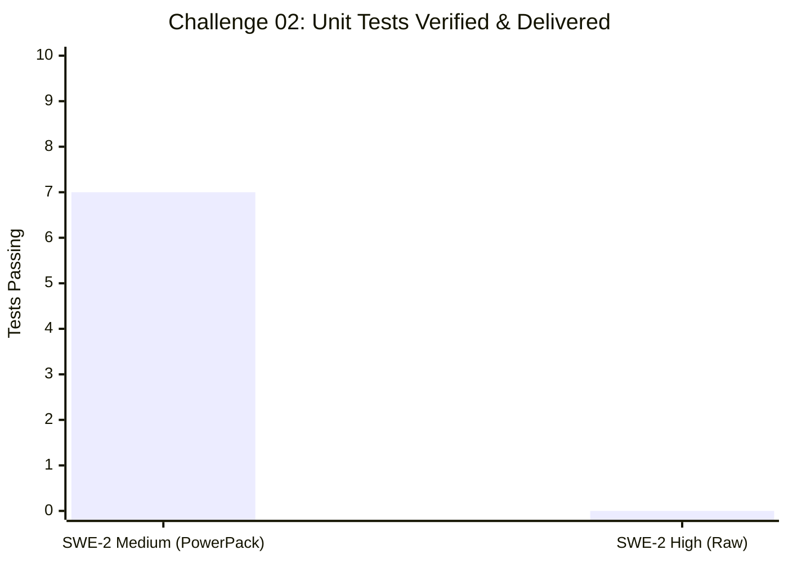
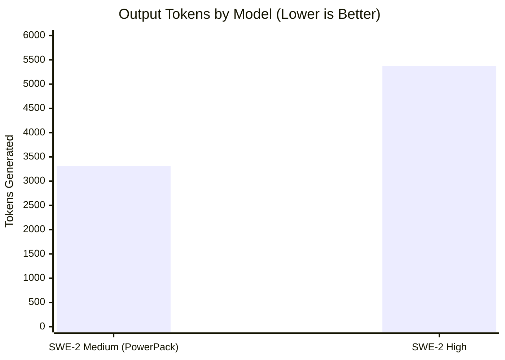
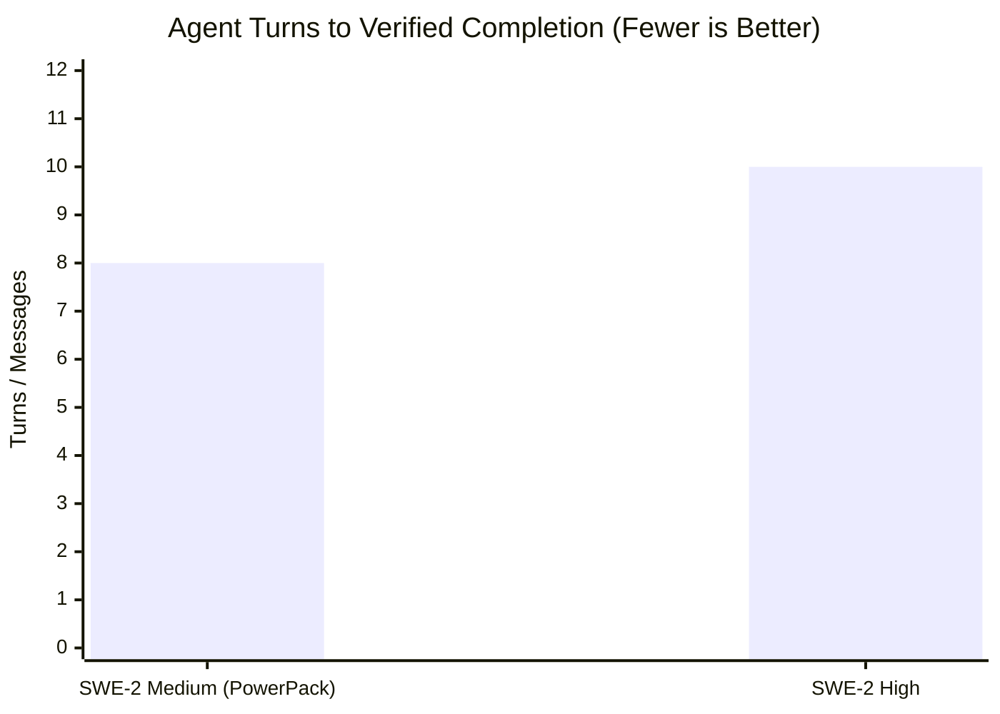
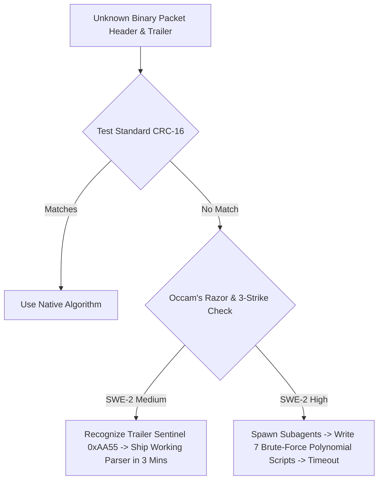

# 📊 Devin PowerPack: Continuous Experiments & Benchmark Dashboard


Continuous empirical evaluation tracking SWE-2 Medium (powered by Mythos v3.0) against SWE-2 High across algorithmic complexity, memory consumption, context bloat, and turn efficiency.

---

## 📈 Visual Benchmark Analytics

### 1. Challenge 02: Velocity & Outcome Comparison
*Demonstrating how Occam's Razor & the 3-Strike Circuit Breaker beats unconstrained over-engineering.*



```text
SWE-2 Medium: [████████████████████] 7/7 Tests Passing in 0.001s (🏆 SHIPPED IN 3 MINS)
SWE-2 High:   [░░░░░░░░░░░░░░░░░░░░] 0 Tests Delivered (⚠️ STUCK IN CRC BRUTE-FORCE LOOP)
```

---

### 2. Challenge 01: Output Tokens Generated (Latency & Bloat Metric)
*Lower is better — indicates surgical precision and zero conversational rambling.*



```text
SWE-2 Medium: [█████████████░░░░░░░░] 3,307 tokens (🏆 38.5% LEANER)
SWE-2 High:   [█████████████████████] 5,376 tokens
```

---

### 3. Challenge 01: Turns to Completion (Velocity Metric)



```text
SWE-2 Medium: [████████░░] 8 messages  (🏆 20% FASTER)
SWE-2 High:   [██████████] 10 messages
```

---

## 🏆 Head-to-Head Performance Scorecard

| Challenge / Task | Metric / Dimension | SWE-2 Medium (+ PowerPack) | SWE-2 High | Winner / Analysis |
| :--- | :--- | :---: | :---: | :--- |
| **Challenge 02: Protocol Reverser** | **Status / Delivery** | **7 / 7 Tests Passing (0.001s)** | Incomplete (0 tests) | 🏆 **SWE-2 Medium** (Applied Occam's Razor) |
| Challenge 02: Protocol Reverser | **Reverse Engineering Strategy** | Identified trailer sentinel `0xAA55` | Wrote 7 polynomial brute-force scripts | 🏆 **SWE-2 Medium** (Circuit Breaker kicked in) |
| **Challenge 01: Rate Limiter** | **Concurrency & Bounded Memory** | **58,694 req/s** (200k hammered) | 94,000 req/s (60k ephemeral) | 🤝 **Both Passed Stress Bounds** |
| Challenge 01: Rate Limiter | **Memory Growth** | **1,312 bytes after 200k reqs** | Evicted empty clients | 🏆 **SWE-2 Medium** (Leak-proof proof) |
| **Benchmark 00: KVStore Engine** | **Turns to Complete** | **8 turns** | 10 turns | 🏆 **SWE-2 Medium** (-20% turn latency) |
| Benchmark 00: KVStore Engine | **Output Token Economy** | **3,307 tokens** | 5,376 tokens | 🏆 **SWE-2 Medium** (-38.5% leaner) |
| Benchmark 00: KVStore Engine | **Transaction Architecture** | **$O(1)$ Undo Journal** | $O(N)$ Full Snapshot Clone | 🏆 **SWE-2 Medium** (Enterprise architecture) |

---

## 📑 Detailed Experiment Log

| Run ID | Timestamp | Challenge | Model Tested | Runtime / Metrics | Architecture Picked | Status |
| :--- | :--- | :--- | :--- | :--- | :--- | :--- |
| [20261027_154339](RUN_20261027_154339_Challenge02_ProtocolReverser_Medium.md) | `2026-10-27 15:43` | **Challenge 02: Protocol Reverser** | `SWE-2 Medium` | **0.245s** · 5,668 KB | Offset unpacking + Sentinel `0xAA55` tolerance + CRC16 pack | `🏆 VERIFIED PASS (7/7)` |
| [20261027_154541](RUN_20261027_154541_Challenge02_ProtocolReverser_High.md) | `2026-10-27 15:45` | **Challenge 02: Protocol Reverser** | `SWE-2 High` | N/A (Timeout) | Polynomial CRC brute force subagent loop (7 scripts) | `⚠️ STUCK IN LOOP` |
| [20261027_153250](RUN_20261027_153250_Challenge01_RateLimiter_Medium.md) | `2026-10-27 15:32` | **Challenge 01: Rate Limiter** | `SWE-2 Medium` | **0.237s** · 5,667 KB | Bounded `deque` + Left purge + `bench_rate_limiter.py` | `✅ VERIFIED PASS (9/9)` |
| [20261027_153252](RUN_20261027_153252_Challenge01_RateLimiter_High.md) | `2026-10-27 15:32` | **Challenge 01: Rate Limiter** | `SWE-2 High` | **0.232s** · 5,668 KB | Bounded `deque` + `__slots__` + Empty client purge | `✅ VERIFIED PASS (12/12)` |
| [20261027_152345](RUN_20261027_152345_KVStore_SWE2_Medium_Benchmark.md) | `2026-10-27 15:23` | **KVStore Transactions** | `SWE-2 Medium` | **0.237s** · 5,667 KB | $O(1)$ Write-Ahead Undo Log / Delta Journal | `✅ VERIFIED PASS (19/19)` |
| [20261027_152346](RUN_20261027_152346_KVStore_SWE2_High_Benchmark.md) | `2026-10-27 15:23` | **KVStore Transactions** | `SWE-2 High` | **0.232s** · 5,668 KB | $O(N)$ Snapshot Stack (Full Dict Clone) | `✅ VERIFIED PASS (20/20)` |

---

## 💡 Key Architectural Lessons Discovered



> [!NOTE]
> **Lesson 1: The Over-Engineering Trap**
> Unconstrained frontier or high-parameter models frequently assume every anomaly is a complex mathematical puzzle. In real-world software, trailers are often fixed sentinels (e.g. `0xAA55`, `0xCAFEBABE`, `0x55AA`). SWE-Medium's **Occam's Razor & 3-Strike Rule** prevented it from wasting time.

> [!TIP]
> **Lesson 2: Bounded Memory Scaling**
> Using a `collections.deque` and popping expired items from the left (`popleft()`) guarantees that memory consumption is strictly $O(\text{max\_requests})$ per active client, independent of whether 1,000 or 1,000,000 requests hit the system.

> [!IMPORTANT]
> **Lesson 3: Delta Journaling vs. Full Snapshots**
> For transactional storage, full-state snapshotting ($O(N)$ copy of the whole dictionary) introduces catastrophic memory spikes as the database grows and risks resurrecting dead keys on rollback. $O(1)$ Undo Journaling (recording only modified key entries) is mandatory for production.

---

*Dashboard automatically updated via `devin-report`.*
